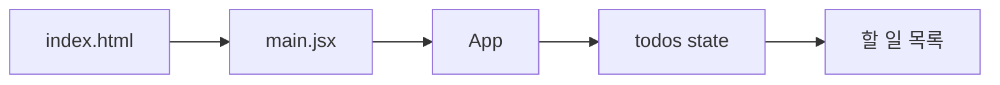
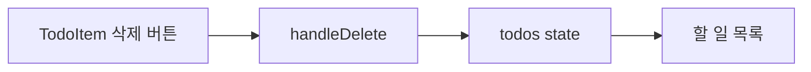
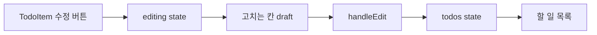

# 시나리오별 구조도

## 할 일 목록 보기

만든 장: project-setup, todo-list
맡는 파일
- todo-app/index.html
- todo-app/src/main.jsx
- todo-app/src/App.jsx
- todo-app/src/index.css

## 할 일 추가

만든 장: todo-add
맡는 파일
- todo-app/src/App.jsx
- todo-app/src/index.css

## 끝난 일 체크

만든 장: todo-toggle, todo-components
맡는 파일
- todo-app/src/TodoItem.jsx
- todo-app/src/App.jsx
- todo-app/src/index.css

## 할 일 삭제

만든 장: todo-delete, todo-components
맡는 파일
- todo-app/src/TodoItem.jsx
- todo-app/src/App.jsx
- todo-app/src/index.css

## 할 일 수정

만든 장: todo-edit
맡는 파일
- todo-app/src/TodoItem.jsx
- todo-app/src/App.jsx
- todo-app/src/index.css
